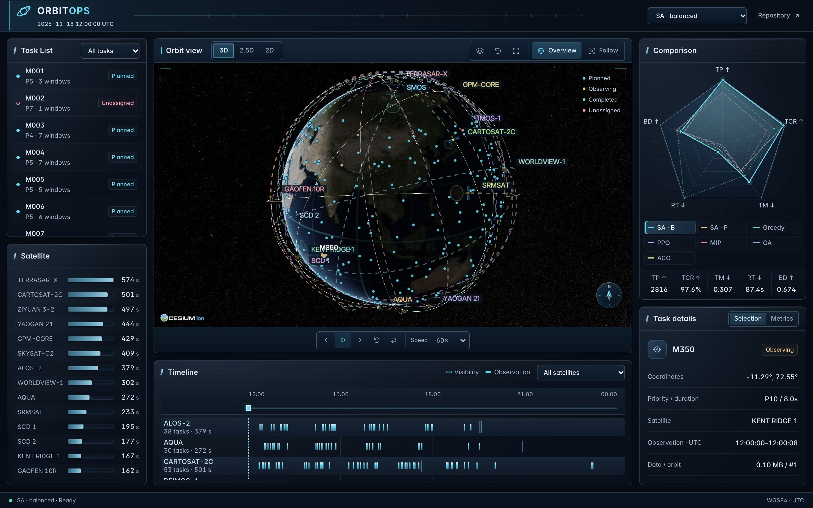

<div align="center">

# OrbitOps Lab

**Earth-observation mission visualization, schedule replay and scheduling experiments.**

[](pyproject.toml)
[](https://github.com/Revincxt/orbitops-lab/actions/workflows/ci.yml)
[](LICENSE)

[Live Demo](https://revincxt.github.io/orbitops-lab/) · [Quick Start](#quick-start)

</div>



## Overview

OrbitOps Lab combines a browser-based satellite mission replay workspace with a
separate Python toolkit for reproducible scheduling experiments.

The read-only workspace visualizes one pinned **EOS-Bench** scenario using imported
orbit samples, ground tasks and scheduling results:
**20 satellites · 500 tasks · 12-hour planning window · 7 reference plans**.
The plans are SA (balanced/profit), Greedy, PPO, MIP, GA and ACO.

- **Orbit views** — a 3D globe, 2.5D/2D maps, satellite models and 3D camera follow.
- **Schedule replay** — forward/reverse playback, timeline scrubbing and synchronized task states.
- **Inspection** — target coordinates, observation windows, satellite positions and observation-time workloads.
- **Plan comparison** — switch between imported plans and view the source TP, TCR, TM, RT and BD metrics.

The Python toolkit provides **11 solvers**, independent schedule validation and
seeded benchmarks for **synthetic single-satellite** scenarios, accessible through
the CLI. These experiments are separate from the demo's multi-satellite reference
model. Neither the hosted demo nor `orbitops lab` runs these solvers or computes
new schedules.

## Quick Start

Requires **Python 3.12+**. From a terminal:

```bash
git clone https://github.com/Revincxt/orbitops-lab.git
cd orbitops-lab
python3 -m venv .venv
source .venv/bin/activate
python -m pip install -e .
orbitops lab
```

Open [localhost:8000](http://127.0.0.1:8000), or try the
[hosted demo](https://revincxt.github.io/orbitops-lab/) without installation.

## Credits & Scope

Demo records come from [EOS-Bench](https://github.com/Ethan19YQ/EOS-Bench); the
imported schedules and reported metrics are retained rather than re-optimized.
Source URLs, hashes and scoped validation results are recorded in the
[reference archive](data/eos-bench/reference.json).

Orbit playback outside the planning window is estimated and executes no tasks.
Rendered attitude includes display-only corrections and smoothing; sensor cones
and footprints are illustrative. This is not live telemetry or flight-grade
simulation, and the replay does not certify full plan feasibility.

[MIT](LICENSE) applies to OrbitOps-authored code; third-party data is separate.
